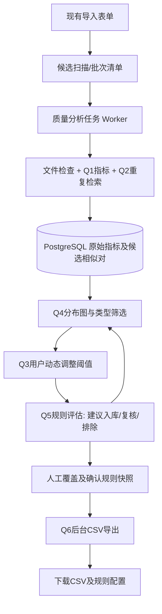

# 图像入库前质量体检系统——详细技术设计方案 V1.0

> 适用环境：现有内网网站，Docker Compose + Nginx + Node/前端 + FastAPI/Python + PostgreSQL；已具备服务器路径导入、图片类别与两级类型管理、SHA-256正式存储能力。  
> 核心交付：每项指标分布图、双阈值动态筛选、三类综合建议、逐图CSV。  
> 非目标：本期不自动删除文件、不自动修改原图、不开发训练数据集、不强制接入FiftyOne/LLM/Agent、不把全部图片传到浏览器。

## 0. 术语及设计边界

- **源文件/候选图片（candidate）**：位于待导入目录中、尚未被质量流程批准的原始文件；即使损坏或重复也必须在批次清单中留下记录。
- **正式原图（asset image）**：已有方案B按SHA-256存放的唯一文件，可被多个候选来源关联。
- **质量指标（metric）**：算法计算出来的数值，独立于判断阈值；例如 `blur_effect=0.67`。
- **指标规则（rule）**：指标方向、复核阈值、严重阈值、启用状态及适用图片类型。
- **建议（recommendation）**：算法给出的 `admit / review / exclude`，即建议入库/建议复核/建议排除。
- **人工决定（manual_decision）**：用户批准或覆盖建议的结果，必须单独存储并保留操作者与理由。
- **评估快照（evaluation snapshot）**：用户确认的一组指标计算版本、阈值规则、图片候选集合及判定结果；滑动时的临时预览**不**自动存成正式快照。
- **四个画像（quality profiles）**：实拍-可见光、实拍-红外、手绘-可见光、手绘-红外；未指定类型进入通用兜底画像，默认不做强烈推断。可后续按位深/设备再细分。
- **完全重复**：SHA-256相同，意味着文件字节相同；**近重复**：pHash相近，仅为疑似候选；**语义相似**：深度视觉特征相近，留到后期。

### 本期范围

1. 在现有导入流程中加入 `扫描预览 → 质量体检 → 阈值调整/人工复核 → 固定评估规则/导出CSV`。
2. 当前质量模块**只给出建议和CSV**，不直接触发批量删除或正式入库；现有入库服务将来可依据人工确认的结果接入。
3. 图片路径、类别仍为已有导入功能的必填字段；标注路径、类型、自定义标签可选；本模块既不解析标签文件，也不占用最多5个自定义标签名额。
4. 保留历史原有菜单/API/数据表的兼容行为；复用登录与权限系统；数据仍在服务器宿主机目录，Worker只读访问候选原图。

## 1. 目标架构与数据流



- **FastAPI**：启动任务、查询指标/直方图、接收阈值、返回预览计数、查询候选、提交快照、提供CSV下载。
- **后台Worker**：遍历文件、逐图解码及计算、pHash查重、聚合统计、生成CSV。耗时任务不在Web请求中同步运行。
- **PostgreSQL**：保存结果、任务状态、规则版本、人工决定、导出记录；使用新 `asset` 相关表，不破坏既有表。
- **前端**：指标分布图+滑块+异常样本浏览+三状态统计；禁止一次请求百万条逐图记录。
- **宿主机磁盘**：保存源图、必要的分析缩略图、CSV；原始图字节不修改。

## 2. Q1：质量指标计算——完整定义

### 2.1 统一预处理和计算规范（务必先实现）

1. 记录原始字节的SHA-256、文件大小、解码是否成功、宽高、通道数、色彩模式、位深、原始数值范围、EXIF方向、源文件最后修改时间/大小（检测运行中被替换）。
2. 文件读取应保留原始数据类型（OpenCV `IMREAD_UNCHANGED`/`IMREAD_ANYDEPTH`，16位TIFF优先兼容 `tifffile`）；仅在**分析内存副本**上做灰度转换和缩放；不能覆盖源文件。
3. 对实拍可见光RGB使用固定灰度算法（记录通道顺序及RGB→灰度规则）；EXIF旋转后再分析空间边缘。Alpha区域须定义一致处理策略并在日志中注明。
4. 清晰度指标使用**固定分析尺度**，建议长边缩小至1024像素、不放大小图；存储分析尺寸和缩放倍率。Laplacian/Tenengrad绝对值依赖尺度、灰度区间、核参数，不能把不同参数版本混合比较。亦可采用局部块统计应对大面积平滑背景。
5. 8-bit可见光使用统一0～1范围。16-bit红外须保存 `raw_min/raw_max/P01/P99`，优先按传感器/数据源固定量程归一化计算可比性指标；**不得仅做单张min-max归一化后判断其原始对比度**。未知辐射量程时设 `comparable=false`，显示相对异常、降级为人工复核。
6. 固定单一熵计算规范：灰度量化为256 bins、以log2计算，理论0～8 bit；量化尺度在同组内保持一致，不因图片不同自动拉伸灰度区间。
7. 对每项指标记录有效性 `valid / unavailable / low_confidence`、算法版本、预处理配置hash。不能计算的项目存NULL并给出原因，不能伪造成0。
8. 模糊/对比度/噪声/熵的指标只是异常线索，不能被当作语义正确性或训练效果的保证。

### 2.2 Q1指标总表

| ID | 图表名称 / 存储字段 | 算法/意义 | 趋势 | UI阈值类型 | 第一版策略 |
|---|---|---|---|---|---|
| F0 | 文件有效性 `decode_status` | 解码失败/不支持/正常 | 分类状态 | 无滑块，分类柱图 | 无法解码：建议排除（仅针对当前批次）；仍保留源记录 |
| F1 | Laplacian方差 `lap_var` | `Var(∇²I)`，边缘与细节活动 | 低值可能模糊 | **低值**：复核/严重双阈值 | 单独显示，但严重模糊可配置需要其他模糊指标佐证 |
| F2 | Tenengrad `tenengrad` | 平均Sobel梯度能量 | 低值可能模糊 | 低值双阈值 | 与F1相关，避免简单当成两项独立证据 |
| F3 | Blur Effect `blur_effect` | `skimage.measure.blur_effect`，0较清晰、1模糊强 | 高值可能模糊 | **高值**双阈值 | 辅助指标，适用性需按类型校准 |
| F4 | RMS对比度 `rms_contrast` | `std(I)` | 低值可能低对比度 | 低值双阈值 | 红外按固定量程单独校准 |
| F5 | 百分位动态范围 `p99_p1` | `P99(I)-P1(I)` | 低值可能低对比度 | 低值双阈值 | 保存原始单位和归一化指标 |
| F6 | 平均亮度 `mean_brightness` | `mean(I)` | 过低/过高可能异常 | **双端区间**：暗/亮分别阈值 | 不能仅凭夜间暗图自动排除 |
| F7 | 暗部比例 `dark_fraction` | `I<固定暗像素阈值`的比例 | 高值可能异常 | 高值双阈值 | 暗像素阈值固定记录在profile中 |
| F8 | 高亮/饱和比例 `bright_fraction` | `I>固定亮像素阈值`的比例 | 高值可能异常 | 高值双阈值 | 红外不能等同于可见光过曝 |
| F9 | 噪声估计 `noise_sigma` | 平坦区域/小波高频的稳健MAD噪声估计 | 高值可能噪声大 | 高值双阈值 | 提供可信度；纹理复杂时改复核、不强排 |
| F10 | Shannon熵 `entropy_8bit` | 256-bin灰度直方图的Shannon熵 | 过低可能信息贫乏 | 低值双阈值 | 手绘低熵可能正常，严重排除默认关闭 |
| F11 | 图像尺寸 `width,height,pixels` | 原始宽/高、像素数 | 过小可能不满足用途 | 可选最小尺寸限制 | 独立于感知质量统计，不强推通用尺寸门槛 |

**图表要求**：每个启用的数值指标都具有自己的分布直方图，图表下面有“复核阈值”和“严重阈值”滑块；低值/高值指标的阈值顺序自动约束。亮度是双端异常，需支持四条阈值线（暗：严重/复核，亮：复核/严重），可用四个滑块或两个区间组件实现。文件有效性、SHA完全重复为**离散分类图**，不能强行套用滑块。

### 2.3 默认规则设计

- 首次扫描提供**分位数建议阈值**（例如低尾5%/15%、高尾85%/95%），仅供人工校准；不是通用的物理阈值或自动删图依据。
- 用户可针对每个指标切换：`启用/禁用`、`只提示/参与综合建议`、`仅复核/允许触发严重建议`。
- 质量指标在四类类型及未指定画像之间分别设置、分别计算统计分布；可按类别、位深、设备过滤观察。禁止不同位深分数无转换混用绝对阈值。
- 建议不简单把所有分数加权形成总分。多模糊指标可用组合条件（如 `blur_effect≥严重 且 (lap_var≤复核 或 tenengrad≤复核)`）；这些组合由规则配置确定，并作可解释展示。
- 质量指标可存在交叉异常，一张图片可能同时模糊和低对比度；仅综合建议三类互斥。

## 3. Q2：完全重复及近重复

### 3.1 SHA-256完全重复

- 逐文件SHA-256，比较**同批次内**及**正式库**；分别记录 `duplicate_scope = batch / library / both`、匹配图片/来源ID。
- 同SHA代表无需再次增加原图，但**来源信息必须保留**。对CSV可将综合建议标为“建议排除新增原图”，原因码 `EXACT_DUPLICATE`，并附 `existing_image_id`；不可将原图片删除。
- 同一SHA在不同类别或类型下的声明不一致，标记 `CATEGORY_CONFLICT`/`TYPE_CONFLICT`，需要复核；与“完全重复不新存一份”这个存储决定分开处理。

### 3.2 pHash近重复

- 第一版计算标准64-bit pHash（固定图像方向、灰度、hash_size、依赖版本），计算Hamming距离 `0..64`。
- 输出每张图片最近候选的 `nearest_candidate_id`/`nearest_existing_image_id`、`phash_min_distance`、`pair_scope`，以及疑似重复配对表。
- 分布：最近邻Hamming距离直方图（不是每一对图片的两两距离直方图）；两个滑块分别控制“高度疑似”和“需要复核”的距离边界。**pHash只默认触发复核，不自动排除。**
- 候选匹配需要覆盖本次批次内部和已有图片库；绝不能对百万张全部两两比较。可在小规模采用BK-tree；大规模评估分桶多索引/二进制向量近邻搜索性能与召回。
- 先按明确的**最大检索距离**预计算候选对并缓存。滑块在已覆盖范围内变动时仅重新评估；如用户加大至尚未检索范围，必须提示“需要扩展近邻搜索”，**不能把未检索到的匹配视为不存在**。
- 不把pHash连通图的传递闭包直接当作一组完全重复文件；相似关系可能出现A像B、B像C但A不像C。提供配对预览并允许人工逐组标记。
- 跨实拍/手绘、跨可见光/红外默认**不自动执行相似性排除**；跨类型检查仅用于辅助查看潜在跨模态对应关系。

## 4. Q3：规则配置、阈值版本和评估逻辑

### 4.1 配置结构（示例值仅为结构占位，未校准）

```json
{
  "profile_key": "photo_visible_8bit",
  "version": 1,
  "preprocess_version": "preprocess_v1",
  "metrics": {
    "blur_effect": {"enabled": true, "direction": "high", "review": 0.55, "severe": 0.85, "severe_enabled": false},
    "rms_contrast": {"enabled": true, "direction": "low", "review": 0.12, "severe": 0.05, "severe_enabled": false},
    "entropy_8bit": {"enabled": true, "direction": "low", "review": 4.0, "severe": 2.0, "severe_enabled": false},
    "mean_brightness": {"enabled": true, "direction": "two_sided", "dark_severe": 0.03, "dark_review": 0.12, "bright_review": 0.88, "bright_severe": 0.97, "severe_enabled": false}
  },
  "exact_duplicate_policy": "skip_new_file_keep_source",
  "near_duplicate_policy": "review",
  "missing_metric_policy": "review"
}
```

规则约束：高风险高值指标 `review≤severe`；高风险低值指标 `severe≤review`；双端指标 `dark_severe≤dark_review<bright_review≤bright_severe`。所有阈值必须处于该指标的有效范围内；提交规则校验需在后端执行。初期所有非文件损坏问题的严重自动排除建议默认关闭或明确要求用户启用。

### 4.2 判定优先级（必须逐图执行）

```python
def recommend(candidate, metrics, profile, similarity):
    if candidate.decode_status != "ok":
        return "exclude", ["DECODE_FAILED"]
    if similarity.exact_duplicate:
        # 只排除新增物理原图；来源记录仍保留；类别冲突另行展示
        return "exclude", ["EXACT_DUPLICATE"]
    reasons = evaluate_all_enabled_rules(metrics, profile, similarity)
    if candidate.file_changed_after_scan:
        return "review", ["SOURCE_CHANGED"]
    if any(r.level == "severe" and r.severe_policy_enabled for r in reasons):
        return "exclude", reason_codes(reasons)
    if any(r.level in ("warn", "severe") for r in reasons):
        return "review", reason_codes(reasons)
    if any_required_metric_unavailable(metrics, profile):
        return "review", ["METRIC_UNAVAILABLE"]
    return "admit", []
```

实际生产中“相似疑似”默认 `review`，人工决定与建议相互独立；只修改阈值绝不能覆盖已保存的人工决策。建议状态应为每次评估快照的函数，手动审核决定具有单独生命周期。

### 4.3 调整时的响应方式

- 拖动滑块时本地立即更新阈值数字/竖线和受影响区间标示；通过250~400ms防抖调用后端API精确计算联合综合状态数量。
- 对并发请求使用 `request_id`/序列号只显示最新返回结果，避免旧请求覆盖新配置。
- **不重新运行图像解码和指标计算**；只读取已存数值重算判定。
- 滑动中的预览仅临时存储；点击“保存规则/冻结评估”才创建永久评估版本，之后导出与其绑定。

## 5. Q4：前端信息架构与交互

### 5.1 界面布局

1. 顶部批次条：批次ID/名称、总文件数、检测状态、计算进度、四类图片类型/类别/位深过滤器。
2. 总览区：建议入库、建议复核、建议排除、未完成/不可评估数量。三种建议计数互斥，三者总和须等于已参与完整判定的候选文件数（明确未处理项另计）。
3. 指标分布区：每张图均包含标题/方向/单位/描述、直方图（40~100 bins，支持对数视图）、阈值竖线、**下方阈值滑块**、启用开关、当前命中数与“查看这些图”入口。
4. 重复区：SHA离散计数、pHash最近邻距离分布与滑块、重复配对并排预览。
5. 样本表格/图库：当前条件下分页显示候选图片、所有指标、风险标签、综合建议、人工决定；支持按指标区间查看和批量人工覆盖。
6. 操作区：恢复默认/保存当前规则/确认评估/导出CSV；只保存快照不触发正式入库。

### 5.2 视觉设计约束

- 每个直方图明确纵轴“图片数”、横轴“指标值及单位”，支持点击区间查看对应图片；显示未计算值的数量。
- 每张图的滑块固定放在**该图下方**，避免一个全局滑块面板难以对应。
- 图上标示严重/复核边界；边界跟随拖动即时更新。
- 多个异常原因可重叠；不能把不同异常的数量直接相加。下方三状态合计由逐图规则计算。
- 筛选更改会影响分布：UI需标明“当前所选范围的分布”与“当前批次总体分布”，可切换。
- 切换图片类型时读取对应规则配置；跨四类汇总时逐图使用所属画像的规则再计数，禁止把四种画像强行共用一组阈值。
- 没有足够样本或指标未校准时，显示明确提示，不把“缺少数据”显示为“质量正常”。

## 6. Q5：综合建议引擎

- 建议三态：`admit`、`review`、`exclude`；单张候选只能有一个综合建议，但可有多个异常原因码。
- 原因码示例：`DECODE_FAILED, EXACT_DUPLICATE, CATEGORY_CONFLICT, TYPE_CONFLICT, BLUR_SUSPECT, BLUR_SEVERE, LOW_CONTRAST, LOW_ENTROPY, HIGH_NOISE, DARK_IMAGE, HIGHLIGHT_CLIPPING, PHASH_NEAR_DUP, METRIC_UNAVAILABLE`。
- `exclude` 是“建议排除本次新入库”，不是删除源图；对于完全重复，仍保存新增来源记录；对于严重质量问题，允许人工覆盖为保留困难样本。
- 对 `category/type` 冲突：即使SHA重复已经导致不新存文件，也必须单独显示冲突标签；冲突不能悄悄覆盖正式库分类。
- 人工审核状态 `not_reviewed/accepted/rejected/needs_review` + `reviewer_id/reason/time` 独立记录。
- 任何点击“正式确认评估/导出”前，都校验候选清单是否仍完整、源文件是否在扫描后发生变化；变化项转复核/重测。

## 7. Q6：CSV导出规范

### 7.1 行级语义

**一条已扫描的源文件对应一行**，包括解码失败、完全重复与未能计算指标的文件。输出的是确认过的评估快照，而非滑动过程中瞬时不一致的状态。

### 7.2 建议CSV字段

```text
batch_id,candidate_id,source_relative_path,original_filename,
category,capture_type,spectral_type,width,height,bit_depth,channels,file_size,
sha256,decode_status,decode_error,content_changed,
lap_var,tenengrad,blur_effect,rms_contrast,p99_p1,
mean_brightness,dark_fraction,bright_fraction,noise_sigma,noise_confidence,entropy_8bit,
exact_duplicate,duplicate_scope,existing_image_id,
phash_64,phash_nearest_distance,nearest_image_id,nearest_candidate_id,
quality_flags,recommendation,manual_decision,manual_reason,
metric_version,preprocess_version,profile_key,profile_version,evaluation_id,exported_at
```

`quality_flags` 用分号分隔代码或JSON字符串编码（CSV正确转义）。未计算字段写空值，同时写对应错误原因；绝不可把NULL强行写0。对外CSV优先相对路径，避免泄露服务器宿主机敏感绝对路径。对于可能被Excel解释为公式的字符串字段，输出Excel兼容版需防止CSV公式注入。

### 7.3 CSV生成

- 用户先点“固定规则/生成快照”，后台以同一候选批次清单和规则版本冻结结果；之后发起导出Worker任务。
- Worker按游标/批次流式读取数据，写入临时`.csv.part`，完整后原子重命名；提供文件行数、SHA-256、成功/失败状态。
- 优先UTF-8（可选UTF-8 BOM便于Excel显示中文）。同时导出 `quality_rules.json` 记录完整阈值和算法版本；CSV写 `evaluation_id` 关联规则。
- 仅提供经权限检查、有效期控制的下载接口；不通过FastAPI把百万条数据先拼接到内存。

## 8. 数据库增量方案

**重要**：必须先检查旧项目是否已存在 `asset.import_batches`/`asset.import_items`/Worker和诊断表；优先复用。以下为**建议逻辑实体**，不是让Agent无条件创建同名表。

| 逻辑表 | 关键字段 | 说明 |
|---|---|---|
| `quality_jobs` | id, batch_id, state, started_at, progress, retry_count, error | Q1/Q2后台任务及进度 |
| `quality_metric_results` | id, candidate_id, sha256, source_fingerprint, preprocess_version, algorithm_version, 指标字段..., metric_status | **不可用规则覆盖的原始指标** |
| `quality_neighbor_pairs` | left_candidate_id, right_candidate_id或existing_image_id, distance, scope, index_version | pHash近重复候选对 |
| `quality_profiles` | id, key, type/spectral/depth, version, config_jsonb, status | 画像规则配置及版本 |
| `quality_evaluations` | id, batch_id, profile_snapshots_jsonb, candidate_set_hash, status, created_by, created_at | **仅确认时落库** |
| `quality_evaluation_items` | evaluation_id, candidate_id, recommendation, flags_jsonb | 每张候选的确认评估结果，唯一(evaluation_id,candidate_id) |
| `quality_manual_reviews` | id, candidate_id, manual_decision, note, reviewed_by, reviewed_at | 人工决定与审核历史 |
| `quality_exports` | id, evaluation_id, state, storage_key, row_count, file_sha256, created_at | 导出任务和文件 |

建议索引：`(batch_id, candidate_id)`、`(candidate_id, algorithm_version, source_fingerprint)`、`(profile_key,version)`、`(evaluation_id, recommendation)`、重复索引中的SHA和pHash索引或近邻结构；对来源记录遵循原系统唯一性策略。

如果来源文件再次修改，不能复用旧指标；哈希/size/mtime等组成的指纹用于失效识别，核心内容验证仍以SHA-256为准。计算版本变化需形成新一份指标结果，避免覆盖不可追溯。

## 9. API设计（只给出建议契约，必须适配既有路由）

| 方法 | 路径 | 作用 |
|---|---|---|
| POST | `/api/assets/imports/{batch_id}/quality/jobs` | 创建/继续体检任务，返回job_id |
| GET | `/api/assets/quality/jobs/{job_id}` | 状态、处理进度、错误数 |
| GET | `/api/assets/imports/{batch_id}/quality/metrics` | 指标概况、有效范围、缺失数、画像列表 |
| GET | `/api/assets/imports/{batch_id}/quality/histograms` | 分类型+过滤器返回各指标直方图 |
| POST | `/api/assets/imports/{batch_id}/quality/evaluate-preview` | 使用临时阈值计算综合计数及原因分布 |
| GET | `/api/assets/imports/{batch_id}/quality/candidates` | 分页获取候选及当前规则下的建议 |
| GET | `/api/assets/imports/{batch_id}/quality/near-duplicates` | pHash配对分页列表 |
| GET | `/api/assets/quality/profiles` | 获取画像规则 |
| PUT | `/api/assets/quality/profiles/{id}` | 保存新画像**版本**，带乐观并发校验 |
| POST | `/api/assets/imports/{batch_id}/quality/evaluations` | 创建确认快照，冻结规则与成员 |
| POST | `/api/assets/quality/reviews` | 审核/覆盖某些候选 |
| POST | `/api/assets/quality/evaluations/{id}/exports` | 创建CSV导出任务 |
| GET | `/api/assets/quality/exports/{id}` | 状态与下载地址 |
| GET | `/api/assets/quality/exports/{id}/download` | 受保护文件下载 |

### evaluate-preview请求示例

```json
{
  "request_id": "ui-38",
  "batch_id": 26,
  "filters": {"category": "rose", "capture_type": "photo", "spectral_type": "infrared"},
  "profile_key": "photo_infrared_16bit",
  "draft_rules": {"blur_effect": {"review": 0.50, "severe": 0.80, "enabled": true}},
  "include_histogram": false
}
```

### evaluate-preview响应示例

```json
{
  "request_id": "ui-38",
  "batch_id": 26,
  "metrics_snapshot_version": "metrics-v1",
  "evaluated_count": 10000,
  "pending_count": 0,
  "counts": {"admit": 7400, "review": 2100, "exclude": 500},
  "flag_counts": {"BLUR_SUSPECT": 1600, "LOW_CONTRAST": 850, "EXACT_DUPLICATE": 300},
  "profile_calibrated": false
}
```

以上都是API格式占位，并非真实统计结果；`flag_counts`有重叠，不能求和成总建议数。

## 10. 实时性能与百万级设计

- **一次算指标**：同一文件哈希/算法版本/预处理版本结果可复用，源内容变化必须失效。
- **分布数据**：后台预计算40~100桶/指标/画像/批次，前端只传聚合结果；极端值展示溢出桶，Laplacian等偏态指标提供log刻度。
- **多阈值综合计数**：不能仅凭各指标直方图求出精确三态数量，因为指标间相关/交集未知。应由服务端对逐图指标执行联合规则（SQL聚合或专用批处理/位图缓存），保证计数准确。
- **响应策略**：UI立即更新本地阈值和图上边界；对服务端动态结果250~400ms防抖、取消旧请求、显示“更新中”。先用PostgreSQL查询验证10万/100万性能，必要时再增加预计算位图/缓存，不能为了性能牺牲准确性。
- **分页样本**：只读取当前页缩略图及几十条指标，不批量加载百万行到浏览器。
- **Q2索引**：pHash近邻索引的构建/扩容由后台Worker完成，前端有覆盖范围提示；阈值超出范围不可用旧候选表做无偏结论。
- **任务恢复**：逐候选任务记录、幂等UPSERT、checkpoint和Worker租约；如使用Postgres作为任务队列可考虑`FOR UPDATE SKIP LOCKED`。
- **环境**：保持Docker bind mount、宿主机持久化、离线Python wheel安装方案；内存与CPU限额可配置。

## 11. 前后端目录增量建议

```text
backend/app/asset_quality/
├── api/{jobs,metrics,profiles,evaluations,exports}.py
├── models/                          # 仅新表、兼容现有ORM
├── schemas/                         # DTO + Pydantic阈值验证
├── services/
│   ├── image_decoder.py            # 8/16位和红外处理
│   ├── metric_registry.py           # 指标插件注册
│   ├── metrics/{sharpness,contrast,exposure,noise,entropy}.py
│   ├── duplicate_service.py         # SHA/pHash及候选检索
│   ├── histogram_service.py
│   ├── quality_rule_engine.py
│   ├── evaluation_service.py
│   └── csv_export_service.py
├── workers/{quality_worker,export_worker}.py
└── tests/
frontend/src/.../asset-quality/
├── QualityDashboard
├── MetricHistogramCard
├── ThresholdControl
├── DuplicatePairViewer
├── CandidateImageGrid
├── RecommendationSummary
└── ExportDialog
```

以上路径仅示意；必须在审查实际工程后采用现有的组件、路由、ORM、迁移和Worker约定。

## 12. 测试集、验收标准和安全边界

### 12.1 算法单测

- 常量图、清晰边缘、人工高斯模糊、添加噪声、暗图、亮图、低对比度图、16位TIFF、透明PNG、旋转EXIF、损坏文件、多页TIFF（未支持时明确拒绝）。
- 模糊越强是否趋势一致（局限须在测试中注明）；亮度左右两侧边界；阈值等于边界时的统一包含规则；NULL指标走复核路径。
- 重复原图、改文件名不改字节、重压缩、裁剪、跨类型近似、同批次/跨库重复。

### 12.2 规则测试

- 一张图片同时触发多个异常，原因全部保留，但仅有一条综合建议。
- 恰好达到阈值的比较方向统一（例如高风险高值用 `>=`，低风险低值用 `<=`）。
- `admit+review+exclude == evaluated_count`；扫描未完成图片额外计为`pending`。
- 改阈值不触发重新解码；保存后的快照不因阈值再次变化而改动。
- 人工覆盖不被重新计算覆盖，旧规则版本和CSV可重新追溯。

### 12.3 集成验收

1. 使用四种图片类型每类不少于几十张的混合测试集，包含异常和重复样本。
2. 测量首次计算、再次复用的耗时，验证Worker中断、重试、容器重建、源文件变化。
3. 检查每个Q1数值指标都有分布图、滑块、数值、命中数，拖动后图中边界及三态数量正确更新。
4. 导出CSV行数与扫描源文件数一致（若仅导出已分析项，必须在界面明确说明并阻止把它称为全量）；随机抽10条与DB结果核对；检查中文、空值和逗号路径的CSV转义。
5. 检查图片无字节变化、正式入库库无未授权变更，原有页面/API回归测试通过。
6. 10万与100万样本的性能由真实内网服务器压测记录，给出P50/P95响应时间、CPU/内存与数据库IO；不凭空承诺某个毫秒值。
7. 人工复核不同类型、不同位深的样本，记录误建议排除率，校准分类型阈值。

### 12.4 安全

- 只允许读取已授权的候选目录，检查路径规范化、符号链接越界、目录遍历及访问权限。
- Worker质量检查只读源数据；CSV文件有访问控制和保留期；日志避免明文输出不必要的敏感绝对路径。
- 禁止自动删除原图；误判可人工覆盖，所有审核与规则版本可审计。

## 13. 分阶段实现和各阶段交付

| 阶段 | 工作 | 验收产物 |
|---|---|---|
| 0 | 只读审查现有项目和数据库，定位预扫描/入库前的插入点 | 增量改造文件清单、风险和回滚方案 |
| 1 | Q1：解码、指标及版本化存储 | 各类示例图的指标结果，离线单元测试 |
| 2 | Q2：SHA + pHash相似候选 | 配对列表、最近邻分布、候选检索性能结果 |
| 3 | Q3+Q5：动态阈值与纯函数建议引擎 | 边界、交集和版本化测试 |
| 4 | Q4：仪表盘、每项分布、每图下方滑块、联动预览 | 可实际操作的页面、计数一致性 |
| 5 | Q6：固定快照、逐图CSV、规则JSON导出 | CSV一致性与校验报告 |
| 6 | 四类数据校准及百万级压力测试 | 分类误判记录、P50/P95性能与旧业务回归 |

## 14. 参考实现文档（供开发者核对，不代表阈值已经校准）

- scikit-image `measure.blur_effect` / `shannon_entropy`：https://scikit-image.org/docs/stable/api/skimage.measure.html
- scikit-image `exposure.is_low_contrast`：https://scikit-image.org/docs/stable/api/skimage.exposure.html
- OpenCV `IMREAD_UNCHANGED` / `IMREAD_ANYDEPTH`：https://docs.opencv.org/4.11.0/d8/d6a/group__imgcodecs__flags.html
- PostgreSQL `SKIP LOCKED`：https://www.postgresql.org/docs/current/sql-select.html
- FastAPI后台任务说明：https://fastapi.tiangolo.com/tutorial/background-tasks/

> 本文是一份待对接现有工程的技术设计，不是已在内网服务器实测的配置。具体阈值、文件路径、表名与API前缀都需要先审查实际项目再确定。

## 15. 关键实现约定：规则计算、结果快照和前端接口

### 15.1 新旧导入流程兼容策略

- 新质量流程作为功能开关 `QUALITY_PRECHECK_ENABLED` 接入。开关关闭时，现有“扫描→导入”完全沿用原先逻辑；开关打开时，新增“扫描→体检→规则确认/CSV导出”的步骤，**不默认提交正式入库**。
- 首次上线只对管理员/测试批次开放；不得修改正式图片库的已有SHA-256唯一性或对象存储键。
- 从现有扫描清单复用候选文件ID；如果旧系统只在正式入库后分配图片ID，需要在入库前提供稳定的 `candidate_id`（例如复用 `import_items.id`），而非强行插入正式 `images` 表。
- 对旧版浏览器或未开启质量体检的批次继续返回旧API结构；扩展接口单独命名空间，避免破坏接口契约。

### 15.2 实施中不可省略的规则验证器

```python
from dataclasses import dataclass

@dataclass(frozen=True)
class ThresholdRule:
    enabled: bool
    direction: str             # high / low
    review: float
    severe: float
    severe_enabled: bool = False

    def validate(self) -> None:
        if self.direction not in ("high", "low"):
            raise ValueError("unsupported direction")
        if self.direction == "high" and self.review > self.severe:
            raise ValueError("high-risk-high: review must <= severe")
        if self.direction == "low" and self.severe > self.review:
            raise ValueError("high-risk-low: severe must <= review")

    def score(self, value: float | None) -> str:
        if not self.enabled:
            return "disabled"
        if value is None:
            return "missing"
        if self.direction == "high":
            if value >= self.severe:
                return "severe"
            if value >= self.review:
                return "warn"
        else:
            if value <= self.severe:
                return "severe"
            if value <= self.review:
                return "warn"
        return "ok"
```

这只是单指标辅助函数，正式系统需额外支持**亮度双端规则、组合条件、置信度、缺失值及人工覆盖**。重大质量风险是否转为 `exclude` 还要检查对应 `severe_enabled`，不能因为返回`severe`就默认排除。

### 15.3 数据库一致性与快照

1. **指标唯一性**：同一候选文件内容指纹+预处理版本+算法版本对应一份有效指标；重算采用追加版本或可追踪的UPSERT，不覆盖已被评估快照引用的历史指标。
2. **规则版本**：每次管理员保存新规则生成版本号；画像规则内明确具体数值、指标方向、启用状态、严重阈值策略。
3. **正式评估**：在同一个可重复读事务/一致性快照范围中冻结候选集合和规则引用，逐候选生成 `quality_evaluation_items`。若导出前文件内容改变，标记快照过期并要求重测或在CSV中保留变更状态。
4. **并发修改**：新规则编辑和人工审核使用版本字段（乐观锁）；两个管理员同时编辑不可静默互相覆盖。
5. **CSV一致性**：导出只读取确认的 `evaluation_id` 对应候选与结果，不再按当前在线滑块临时查询一遍，以免导出时混用不同阈值。

### 15.4 前端单张指标卡片数据契约

```json
{
  "metric_id": "blur_effect",
  "display_name": "模糊程度",
  "direction": "high",
  "unit": "0~1",
  "scope": "photo_visible_8bit",
  "histogram": {"edges": [0.0, 0.2, 0.4, 0.6, 0.8, 1.0], "counts": [80, 150, 60, 30, 10]},
  "missing_count": 3,
  "thresholds": {"review": 0.55, "severe": 0.85, "severe_enabled": false},
  "threshold_editable": true,
  "computed_at": "2026-11-20T10:00:00+08:00",
  "algorithm_version": "blur_v1"
}
```

示例数字仅说明协议，实际需来自数据库计算。每张卡片都从此类数据渲染，避免按每个指标写一套互不一致的前端判定代码。

### 15.5 对于百万级准确计数的技术策略

**不能**将各指标的一维直方图独立调整后直接推导三类最终数量，因为重叠情况无法从边缘分布恢复。推荐三层实现：

- **第一层（先做）**：数据库按当前过滤条件读取各候选的数值列，执行统一判定逻辑，聚合返回互斥计数。为确保和CSV一致，评估规则尽量封装为共享可测试的逻辑组件；如果SQL表达式与Python导出都存在，实现黄金测试数据的逐行对比。
- **第二层（有性能瓶颈再做）**：缓存某批次、画像和规则hash对应的计算结果，滑块变化后采用防抖与请求取消；缓存命中不重复全量扫描。
- **第三层（有压测证据后）**：使用分段预计算或Roaring Bitmap之类的位图加速多指标并集/交集；仅用于计数加速，正式CSV仍以确认的逐行评估为准。直方图分桶近似阈值必须向用户标明，不能冒充精确计数。

**关键性能验收**：分别用1万、10万、100万模拟/真实候选指标测试，记录“滑块请求响应时间P50/P95、数据库CPU/内存占用、生成CSV速度”；超标时先定位查询/索引瓶颈，再增加缓存，不预先假定服务硬件能力。

### 15.6 错误与空数据约定

| 情况 | UI显示 | 规则处理 | CSV |
|---|---|---|---|
| 解码失败 | 文件损坏、无法预览 | 建议排除本次入库 | `decode_status=failed` + `decode_error` |
| 图片有效但某指标算法不适用 | “不适用”，不画伪造零值 | 若为必需指标则复核，否则跳过 | 对应字段空，给`metric_status` |
| 16-bit红外量程未知 | 显示“不可跨图直接比较” | 与量程有关的严重阈值禁用 | 保存原始动态范围与可比性字段 |
| 完全重复但来源类别冲突 | 显示“已存在+分类冲突” | 不新增原图、待人工审查标签 | 同时记录两个原因码 |
| pHash索引搜索范围不足 | 明确提示“搜索未覆盖该阈值” | 近重复状态不可声明为无重复 | `similarity_coverage=incomplete` |
| 后台处理中用户调整阈值 | 显示已处理数量/待处理数量 | 仅对已完成候选给实时建议 | 导出全量前要求任务完成或明确部分导出 |
| 来源文件扫描后被替换 | 显示“源文件已变化，需重测” | 建议复核/阻止正式冻结 | `content_changed=true` |
| 用户连续快速滑动 | 竖线立即变化、结果更新中 | 只采纳最新响应 | 不产生持久快照 |

